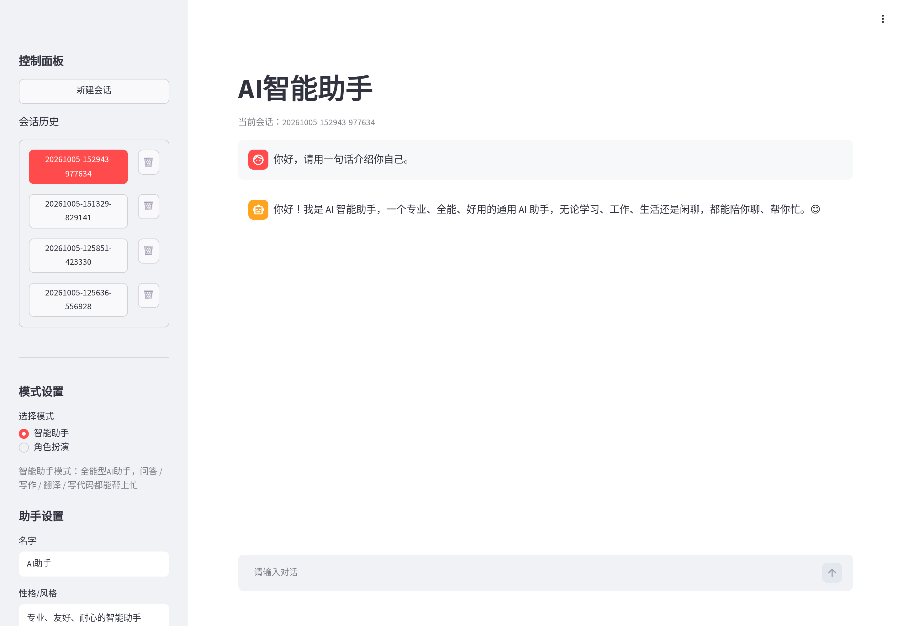
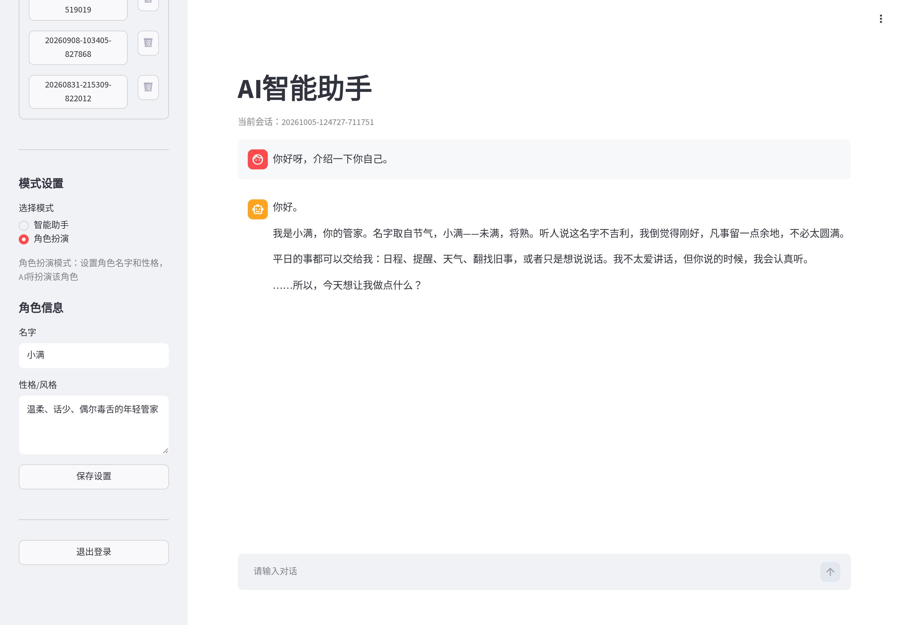
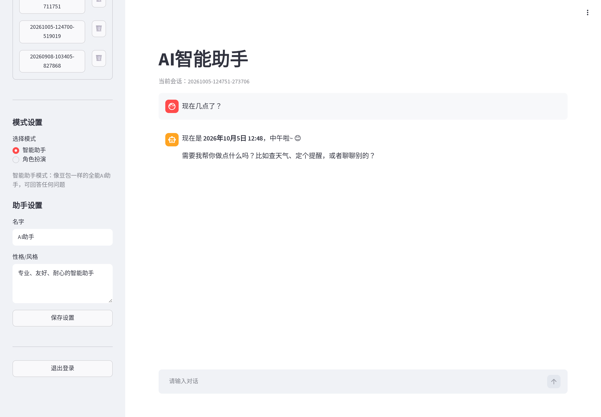
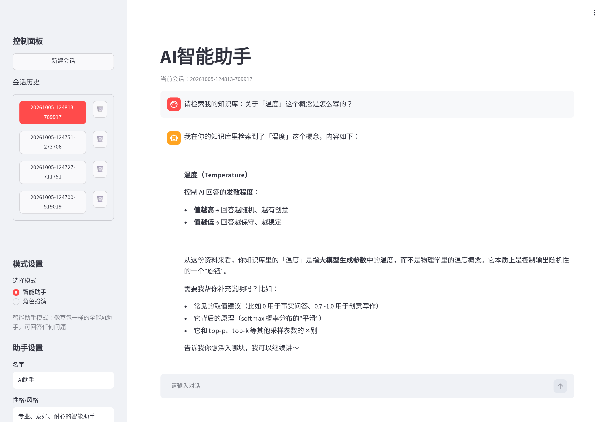
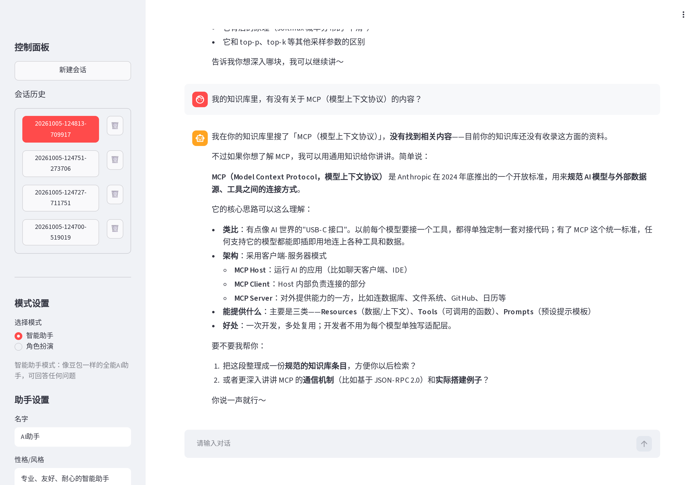
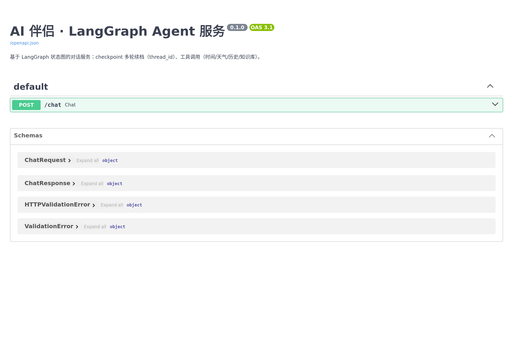
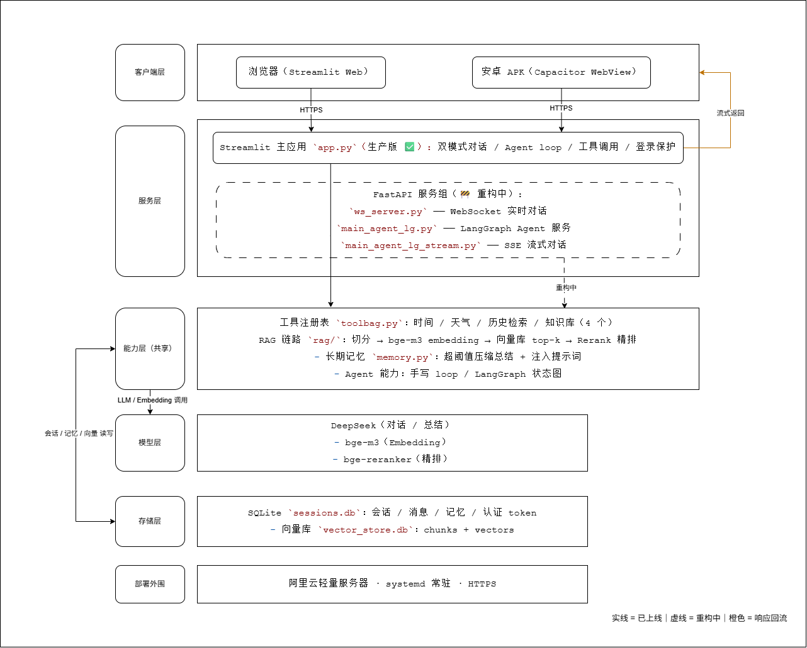
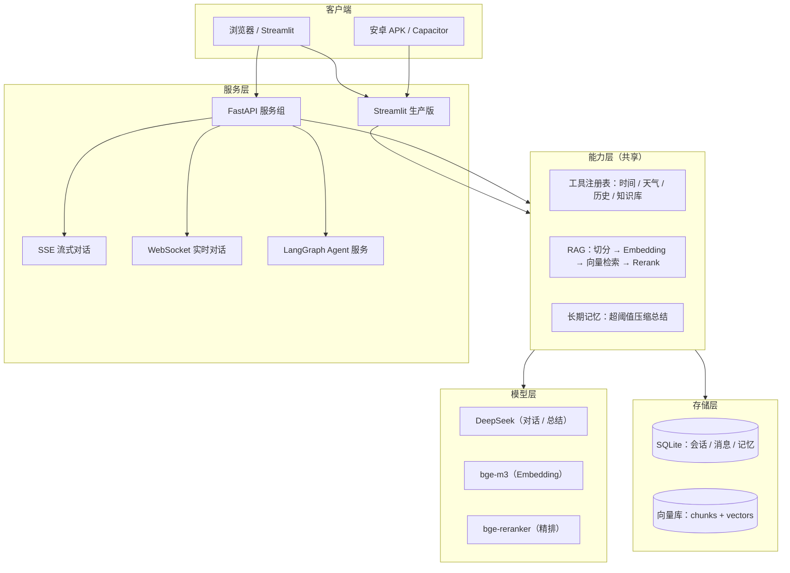

# AI 智能助手 · 作品展示

> 一个**已生产运行**的 AI 聊天助手：Streamlit 生产版 + FastAPI 服务化后端（SSE 流式 / WebSocket 实时 / LangGraph Agent），
> 底层手写 Agent loop、RAG 检索链路与长期记忆机制。

**Python · FastAPI · LangGraph · OpenAI SDK · RAG · SSE · WebSocket · SQLite · Docker · Linux 部署**

> 本仓库是**脱敏后的核心实现展示**。完整生产工程包含登录、部署配置、个人数据与会话库，未公开；
> 这里保留的是最能说明技术能力的代码与工程决策。

---

## 30 秒速览

- 把一个真实在用的 AI 助手，从 Streamlit 单体重构为 **FastAPI 服务化后端**
- **手写** Agent loop：模型决策 → 工具调用 → 结果回流 → 再决策，配最大轮数保险丝与工具容错
- **手写** RAG 全链路：切分 → bge-m3 Embedding → 向量库 top-k → bge-reranker 精排 → 有则答、无则拒
- 流式对话：SSE 六类事件，首字延迟从 **1.44s / 45.12s** 优化到 **约 1s**
- 实时对话：WebSocket 六类事件、连接即会话、连接池管理、房间广播、断连清理
- LangGraph：State / 条件边 / checkpoint + thread_id 多轮续档 / token 级流式外传

---

## 演示截图

| 聊天主界面 | 角色扮演（双模式） | 工具调用 |
|---|---|---|
|  |  |  |

| RAG 命中 | RAG 无则拒答 | FastAPI / Swagger |
|---|---|---|
|  |  |  |

> 截图来自生产版与本地服务化版本；已确认不含密钥、服务器地址或真实个人信息。
> 另：`screenshots/07-swagger-response.png` 是 Swagger Try-it-out 的真实 200 响应。

---

## 系统架构



> 架构图 V2（2026-09）。图中 FastAPI 服务组标注为“重构中”；截至 2026-10，SSE / WebSocket / LangGraph Agent 均已在本地验证通过。



---

## 关键工程问题与解法

| 问题 | 现象 | 解法 |
|---|---|---|
| **首字延迟** | 同一接口首片 1.44s vs 45.12s，像是模型很慢 | 时间戳三分法定位：不是模型慢，是**思考阶段没有 content 可转发**；把 `reasoning_content` 作为 thinking 事件转发，首字降至约 1s |
| **流式 tool_calls** | 多工具并行时参数碎片交错，直接拼接会得到坏 JSON | 按 `index` 归组、按调用 id 分别拼接；完整后再 `json.loads`，异常兜底 |
| **孤儿消息** | 工具执行抛异常后，assistant 的 `tool_calls` 已入库、`tool` 结果没入库，会话永久 400 | **先算后写**：所有工具执行完、结果都拿到，再一次性写 assistant + tool；工具异常也返回 `{"error": ...}` |
| **同步工具阻塞事件循环** | 一次工具调用让整个 WS 服务卡 3.9s | 用 `asyncio.to_thread()` 把同步工具丢进线程池，事件循环恢复 |
| **断连取消** | 客户端断开后上游还在生成，浪费 token | 捕获 `asyncio.CancelledError` 后显式 `raise`，让取消传播到上游 |
| **SSE vs WebSocket** | 不知道该选哪个 | 三问：服务端要不要主动说话 / 客户端要不要还能开口 / 要不要广播；协议层与应用层分离，换传输不改事件协议 |

---

## 核心实现导读

| 文件 | 看什么 |
|---|---|
| [`src/agent_loop.py`](src/agent_loop.py) | 手写 Agent loop、流式 tool_calls 分片拼接、保险丝、先算后写、工具容错 |
| [`src/rag_pipeline.py`](src/rag_pipeline.py) | 重叠窗口切分、bge-m3 Embedding、手写向量库 top-k、bge-reranker 精排、有则答/无则拒 |
| [`src/langgraph_agent.py`](src/langgraph_agent.py) | State / 条件边 / checkpoint + thread_id / token 级流式 / 工具节点 |
| [`src/sse_stream.py`](src/sse_stream.py) | FastAPI `StreamingResponse` + 异步生成器；`token` / `node` / `done` 事件 |
| [`src/ws_server.py`](src/ws_server.py) | WebSocket 六类事件、连接即会话、连接池、房间广播、断连清理 |
| [`src/memory.py`](src/memory.py) | 长期记忆压缩：超阈值总结最老消息，失败不丢历史 |

> 说明：为了可读性，展示代码做了适度简化（如天气/历史工具用示例实现），核心链路与生产版一致。

---

## 快速开始

```bash
python -m venv .venv
source .venv/bin/activate          # Windows: .venv\Scripts\activate
pip install -r requirements.txt

cp .env.example .env
# 编辑 .env，填入 DEEPSEEK_API_KEY / SILICONFLOW_API_KEY

# SSE 流式服务（Swagger: http://localhost:8000/docs）
uvicorn src.sse_stream:app --reload --port 8000

# WebSocket 服务（聊天 + 房间广播）
uvicorn src.ws_server:app --reload --port 8001

# LangGraph Agent 命令行演示
python -m src.langgraph_agent
```

> RAG 示例需要先构建向量库（`data/vector_store.db`）。本仓库不包含任何真实知识库数据。

---

## 目录结构

```text
.
├── README.md
├── requirements.txt
├── .env.example
├── docs/
│   └── architecture.png
├── screenshots/
│   ├── 01-chat.png
│   ├── 02-roleplay.png
│   ├── 03-tool-call.png
│   ├── 04-rag-hit.png
│   ├── 05-rag-refuse.png
│   ├── 06-swagger.png
│   └── 07-swagger-response.png
└── src/
    ├── agent_loop.py        # 手写 Agent loop
    ├── rag_pipeline.py      # RAG 全链路
    ├── langgraph_agent.py   # LangGraph 状态图版
    ├── sse_stream.py        # FastAPI SSE
    ├── ws_server.py         # FastAPI WebSocket
    └── memory.py            # 长期记忆压缩
```

---

## 关于完整工程

- 生产版：Streamlit + SQLite + 阿里云 HTTPS + systemd + 安卓 APK，真实用户日常使用
- 服务化版：FastAPI 会话 CRUD / SSE / WebSocket / LangGraph Agent，本地验证通过
- 完整仓库包含登录鉴权、部署配置、会话数据与个人知识库，**不对外公开**
- 本仓库只保留可公开的技术实现与工程决策；如需进一步了解，可联系作者

---

**作者**：ccxq-19 · 2026.10

> 如果这个项目对你有帮助，欢迎 Star ⭐
